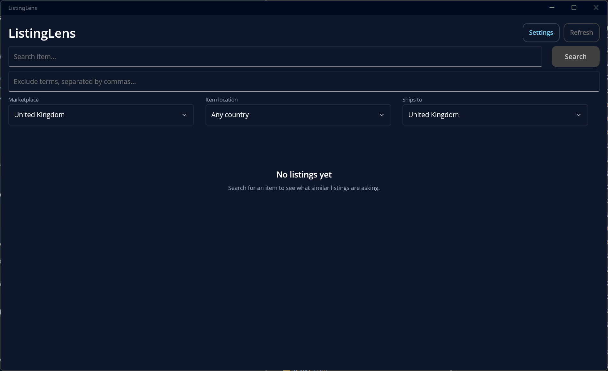
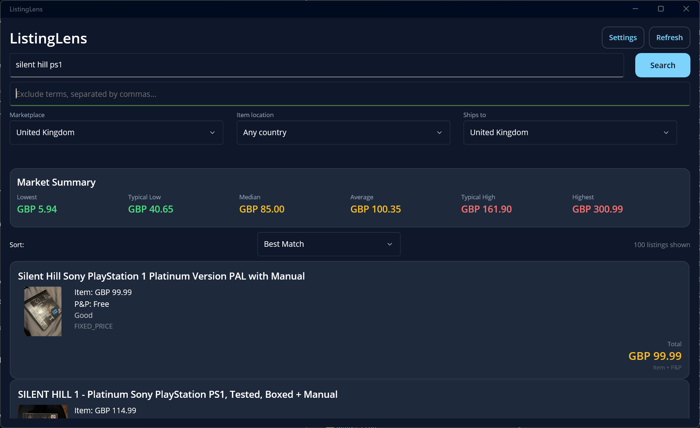
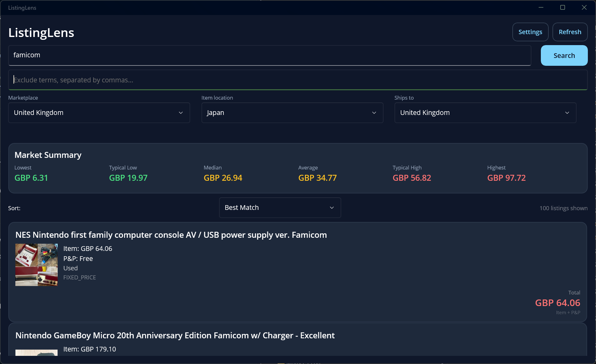
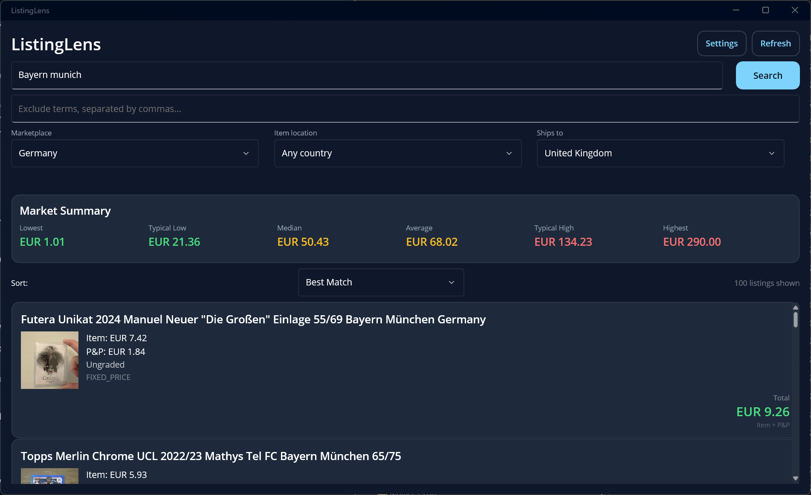

# ListingLens

ListingLens is a small .NET MAUI app for checking what similar items are currently listed for on eBay. It searches five marketplaces through eBay's official Browse API and turns the results into a quick price summary, so you can sanity-check a price before buying or selling.

> **It's a research tool, not a shop.** ListingLens doesn't place bids, buy items, handle payment, or ask for your eBay password. Tapping a listing opens it on eBay's website or in the eBay app, where you can view the item and complete the purchase there.

> **These are active listings, not sold prices.** The Browse API returns what sellers are asking now, not what items have actually sold for. Treat the summary as a snapshot of the current market rather than a sold-price history.

## Screenshots

Screenshots from the Windows build using live eBay listings.

| | |
|---|---|
|  |  |
|  |  |

## Features

- Searches eBay UK, US, Germany, France and Australia in one place.
- Filters by item location and delivery country, and lets you exclude terms from the search.
- Summarises the results with lowest, typical low, median, average, typical high and highest prices. Obvious outliers are removed with an IQR (interquartile range) filter.
- Automatically separates bundles, partial items, for-parts listings and reproductions, and leaves them out of the summary so they don't skew the numbers.
- Shows item price, postage and total for each listing, and can sort by price or by how close each one is to the median.
- Colour-grades prices against the typical range: green below, amber within, red above.
- Caches recent searches for 10 minutes; **Refresh** bypasses the cache for live data.
- Retries temporary network and eBay failures automatically.
- Opens any listing on eBay when you tap it.

## Built with

- .NET 10 and .NET MAUI (Windows, Android, iOS and Mac Catalyst)
- CommunityToolkit.Mvvm
- eBay Browse API with OAuth client credentials
- Microsoft.Extensions for dependency injection and configuration

## Setup

### 1. Get eBay API keys

You'll need your own eBay developer keys:

1. Create a free account at the [eBay Developers Program](https://developer.ebay.com/).
2. Create an application keyset for Sandbox and/or Production.
3. Note the **App ID (Client ID)** and **Cert ID (Client Secret)**.

Sandbox keys work, but they return very little useful data. Use Production if you want real listings.

### 2. Add your keys

ListingLens doesn't ship with keys. The easiest way is inside the app:

1. Select **Settings** at the top of the app.
2. Use the eBay API keys panel to paste your Client ID and Client Secret.
3. Choose `Production` for real listings or `Sandbox` for testing.
4. Press **Save**.

The app opens this panel automatically the first time it starts without keys. Keys are stored in the platform's secure storage on that device only, so you'll need to enter them again on another device. They are never written to the project folder.

For development, you can use .NET user secrets or environment variables instead. If nothing is saved in the app, ListingLens falls back to these:

```bash
dotnet user-secrets set "Ebay:ClientId" "YOUR_EBAY_CLIENT_ID"
dotnet user-secrets set "Ebay:ClientSecret" "YOUR_EBAY_CLIENT_SECRET"
dotnet user-secrets set "Ebay:Environment" "Production"
```

Environment variables work too: `Ebay__ClientId`, `Ebay__ClientSecret` and `Ebay__Environment`. The environment is `Sandbox` when not set, or `Production`.

`Resources/Raw/appsettings.example.json` shows the expected configuration shape with placeholders. Never put real keys in a file tracked by git.

If eBay rejects the keys, check that they were entered correctly and that the Sandbox/Production setting matches the keyset they came from.

### 3. Build and run

You'll need the .NET 10 SDK and the MAUI workload:

```bash
dotnet workload install maui
```

From the project folder, build and run on Windows:

```bash
dotnet build -f net10.0-windows10.0.19041.0
dotnet run -f net10.0-windows10.0.19041.0
```

For Android, connect a device or start an emulator first:

```bash
dotnet build -f net10.0-android
dotnet build -t:Run -f net10.0-android
```

The debug APK is written to `bin/Debug/net10.0-android/com.listinglens.app-Signed.apk`.

iOS and Mac Catalyst builds need a Mac with Xcode.

The project selects targets by build OS:

- **Windows:** Windows + Android
- **macOS:** iOS + Mac Catalyst + Android
- **Linux:** Android

The Apple targets are only included when building on macOS, so a Windows Release build no longer tries to build Mac Catalyst or iOS.

## Project layout

```
API/          eBay OAuth and Browse API clients
Models/       API response models and app models
Services/     Marketplace list and secure credential storage
Statistics/   Listing classifier and price statistics
ViewModels/   MVVM view models
MainPage.xaml Search UI
```

## Disclaimer

ListingLens is an independent project and is not affiliated with or endorsed by eBay Inc. Use of the eBay API is subject to the [eBay API License Agreement](https://developer.ebay.com/join/api_license_agreement).

## License

MIT. See [LICENSE](LICENSE).
